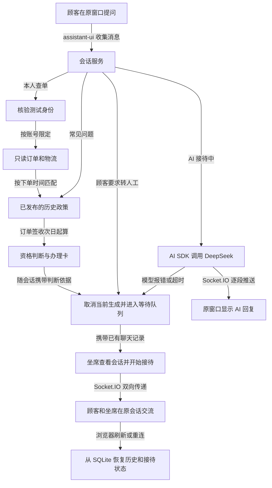

# 智能客服系统

双击 `打开工作导航.cmd`，或打开[客服工作导航](http://127.0.0.1:4873/hub)，即可进入顾客窗口、坐席工作台、店铺资料管理或独立调试后台。各页都可通过「工作导航」返回。四个入口的名称、地址和说明集中在 `shared/pages.ts`。

顾客在同一个网页会话里与 DeepSeek 和人工客服对话。服务端保存聊天历史和接待状态，浏览器通过 Socket.IO 同步。默认只监听本机，供一个值班坐席使用。

## 店铺资料怎么录入

双击 `打开店铺资料管理.cmd` 或打开[本机店铺资料管理](http://127.0.0.1:4873/merchant)。管理页单独运行在本机客服服务上，信任可以操作这台电脑的人，免密使用。顾客、坐席与只读调试后台各有自己的入口。

本次上手样例使用「茶具体验周（验收）」活动。两单对照、坐席交接和浏览器截图见[店铺资料管理验收记录](验收/店铺资料管理验收.md)。

| 资料 | 怎么填写 | 顾客查到什么 |
| --- | --- | --- |
| 商品资料 | 每个可销售规格一个 SKU，填写名称、型号、类别、已确认事实和来源 | 查单时能核对成交规格及该 SKU 现有的商品资料 |
| 已售订单 | 每个商品一行，填会员 A/B、订单号、行号、成交规格、数量、渠道、活动及北京时间。先建 SKU，同批导入时可放在同一工作簿里 | 登录账号只能查本人订单。成交快照和物流时间会进入判断卡 |
| 政策版本 | 同一条款沿用编号，每次改规则新建版本。填写店铺、渠道、活动、生效及可选失效时间、天数和原文 | 按订单下单时间选已发布版本，签收次日算第 1 天。需要核对额外条件时，办理卡会给出原文并转到坐席 |
| 常见问答 | 填常用问法、其他问法、标准答复和来源。资料核实后选择「已审核」 | 顾客可用登记的问法提问，客服引用经审核的答复 |

**Excel 导入**　在管理页下载原模板，保留第 4 行的中文表头，从第 5 行开始填写。点「导入 Excel」选择文件，先预览四类资料的行数、样例和提示，再确认。只填有资料的工作表即可。文件最多 5 MB。一个批次有错误时整批都可以修正后再提交。模板里的新政策即使标记「已发布」，也会先存为草稿。

**政策试算与发布**　在「政策版本」打开草稿的试算入口，选择同店铺、渠道和活动的两笔订单。修订已有规则时，选一笔在新版本生效前下单、一笔在生效后下单。首个版本可用两笔下单时间不同的适用订单。试算页按同一模拟时钟并排列出发布前后的版本、期限和理由。核对后确认发布即可在顾客窗口查询。通过本后台发布的版本都有「试算记录」，可与已发布原文和会话内保存的历史卡一起复查。

## 把转人工反馈变成可验证的修订

1. 坐席在原会话点「开始接待」和「标记转人工原因」，选顾客原话与原因。问答案例填写正确答复，政策案例选择预期的退货判断。顾客直接要求人工、系统异常等情况也可以只记原因。
2. 在[店铺资料管理的坐席反馈页](http://127.0.0.1:4873/merchant#feedback)打开案例。查看顾客当时收到的答复及坐席预期，然后新建或复制现有问答、政策，另存修订草稿。政策还要选择适用范围内的两笔对照订单。
3. 点「运行历史回放」，逐条看原问题、坐席预期、回放时的已发布版本和修订结果。问答按经确认的完整答复核对；退货政策按原订单事实和原判断时间重算，并列出结论、依据版本与期限。相关历史案例和政策试算均通过后可点「发布修订」。发布后，新会话可以用同样的问题复问，原会话里的历史答复留档。
4. 反馈详情里的「查看此会话的模块地图」打开独立调试后台。依次点「坐席反馈」「运营修订」「历史回放」「修订发布」查看案例编号、修订、通过数或拦截原因。顾客原话、坐席备注和答复明细在运营页查看。

## 试一笔订单

### 单件退货、会话办结与复问

在「我的订单」选择一笔有商品明细的订单。「退货范围」可选整单或具体商品行，选择商品后填写申请数量。系统按该行的成交活动和签收时间计算期限。商品行和数量会随判断卡交接给坐席。模拟样例 `LINE-DEMO-100` 属于账号 A，旅行杯和防滑杯套适用不同期限。

坐席回复后可以点「办结会话」，再从「已办结记录」查看。顾客在原窗口发出新消息后，原会话重新进入等待队列。独立调试后台的「会话路由」保留办结和重开的时间。

新建政策反馈时，坐席填写正确结论、完整条款编号与版本、北京时间截止日，也可明确标记无适用版本或无截止时间。历史回放按项核对，差异出现在运营案例和模块地图中；早期只登记过结论的案例仍按当时的标注回放。修订常见问答时可选一条已有答复，将顾客原话加入其中，再登记易混淆问法。反馈修订在发布前会一并检查这些反例。

[第三版验收记录](验收/第三版闭环验收-20261122.md)包含本机案例链接和实测数据。`npm run accept:upgrade` 可在独立的临时模拟店铺重新执行整条流程。

### 测试账号和基础订单

在顾客窗口的「订单与售后」选账号 A，输入公开演示口令 `1111`，点击「登录测试账号」。账号 B 的口令是 `2222`。登录和切换都会开始一个独立会话。选择「我的订单」后可以点「查订单物流」「判断能否退货」，也可以直接在聊天中输入「查一下 DEMO-1002 的物流」，接着问「这单还能退吗？」。访客可从「常见问题」查阅已发布条款。

| 测试单 | 可检查的情形 |
| --- | --- |
| A 的 DEMO-1001 | 11 月 14 日下单，V1 给 7 个日历日，截止 11 月 23 日 23:59:59 |
| A 的 DEMO-1002 | 11 月 15 日下单，V2 给 14 个日历日，截止 11 月 30 日 23:59:59 |
| A 的 DEMO-1003 | 缺少签收记录，交给人工核对起算点 |
| A 的 DEMO-1004 | 模拟订单接口没有及时返回，由真实超时逻辑转入人工队列 |
| A 的 DEMO-1005 | 两条同优先级规则同时匹配，坐席可以展开两个版本原文 |
| B 的 DEMO-2001 | B 的本人订单，可用于演练跨账号隔离 |

这些订单、账号和政策均为单店演示数据。办理时钟固定为北京时间 **2026-11-24 00:00:00**。前两笔订单均在 11 月 16 日签收，从次日算第 1 天。订单服务和退货卡提供只读核验。点击最新判断卡的「解释这次判断」会调用已配置的 DeepSeek，模型通过 AI SDK 工具选择解读次序，结论、期限及条款原文来自已经保存的判断。

点「转人工」，在坐席工作台选择同编号会话。展开「人工交接」可查看诉求、转接原因、核验事实和条款。先前的逐笔判断可在聊天中回看。打开独立调试后台，选相同会话，点击「身份核验」「订单查询」「条款检索」「资格判断」查看结果、耗时和适用版本。

## 打开与试用

1. 双击 `启动顾客窗口.cmd`。向 AI 提问，或点击「转人工」。
2. 双击 `打开坐席工作台.cmd`。在会话队列里选择等待接待的顾客，可以先写回复草稿。点「开始接待」后，原草稿可继续编辑，点「发送消息」才会送达。等待接待期间，顾客也能补充消息。
3. 回到顾客窗口可继续对话。刷新同一浏览器页面后，历史和接待状态自动恢复。要另试一位顾客，可以使用独立的浏览器配置或无痕窗口。

顾客入口为 `http://127.0.0.1:4873/`。本机直接打开 `http://127.0.0.1:4873/agent` 即可免密进入坐席队列。双击启动器也会打开同一页面，并按需启动服务。

## 独立调试后台

双击 `打开调试后台.cmd`，或打开 [本机调试后台](http://127.0.0.1:4873/debug)。这个页面使用独立的只读连接，可与顾客窗口、坐席工作台同时打开。设置了 `SUPPORT_AGENT_KEY` 时，调试入口使用同一个本机访问密钥。

按下方模块地图检查时，先选近期会话或输入顾客窗口里的编号末六位，再点图中的模块，查看对应源码、运行依据和观测时间。切换到会话轨迹，可以核对生成、取消、转人工、接单和回复写入的先后顺序。新事件会触发更新，后台也会定时重新读取。

同一位顾客可以开多个标签页，连接数按标签页的实时连接统计。对话组件挂载后会单独回报；旧版页面刷新后才开始回报。模型只配置了密钥时显示「已配置」，有实际调用结果后才显示成功或失败。人工回复的保存记录表示服务端已写入，顾客是否已读由其他证据判断。

模块地图默认列出最近更新的 50 个会话，会话轨迹最多展示最近 80 条事件。需要追查完整过程时，打开[流程日志](http://127.0.0.1:4873/debug?trace=)，输入订单号、完整流程编号（`TR-` 开头）或步骤编号（`EV-` 开头）。时间线支持翻页，时间统一显示为北京时间。

每个客服会话沿用同一个流程编号。每次下单、提问、AI 或规则答复、转接、坐席操作、办结与重开都有各自的步骤编号。顾客可以在测试账号的订单面板模拟下单，提交成功后就能按订单号查起。同一订单有多次咨询时，可以分会话查看。点击一条回复的原文入口可核对当时的消息或售后判断卡。

流程日志保存在本机 `data/sessions.sqlite`。旧会话按留存的订单、消息、判断卡、办结记录及诊断日志补录，页面标示历史来源。旧版从未记录的环节无法追溯。`npm run accept:trace` 可在独立模拟店铺反复验收下单、客服应答、转接、办结、重开、重复提交和订单归属拦截。

## 运行和开发

使用 Node.js 24.14 或更高的 24.x 版本。真实 AI 需要服务端环境变量 `DEEPSEEK_API_KEY`。默认模型为 `deepseek-flash`，可以通过 `DEEPSEEK_MODEL` 替换。本项目读取现有环境配置，源码、前端包和运行日志均不需要保存模型密钥。

```sh
npm ci
npm run build
npm start
```

前端开发时保持后端运行，另开终端运行 `npm run dev`，Vite 会代理 API 与 Socket.IO 到本机 4873 端口。生产构建由同一个 Node 进程提供页面和实时服务。可通过 `PORT` 替换监听端口，通过 `SUPPORT_DATA_DIR` 指定数据目录。如果以后需要坐席密钥，设置 `SUPPORT_AGENT_KEY` 并重启服务，即可启用密钥验证。

## 模块地图



| 想改的功能或现象 | 首先检查 |
| --- | --- |
| 顾客窗口、转人工入口、刷新恢复 | `client/Customer.tsx`、`client/state.ts` |
| 坐席登录、队列、接单 | `client/Agent.tsx` |
| 聊天呈现、流式草稿、输入框 | `client/Transcript.tsx`，这里复用 assistant-ui 的运行时和消息组件 |
| 双方连接、重连、消息确认 | `client/useLiveFeed.ts` 与 `server/realtime.ts` |
| AI 为什么转人工、接管后还能否生成 | `server/service.ts`，负责状态切换、取消生成与拒收迟到片段 |
| 模型、提示词、超时及回复内容 | `server/ai.ts`，通过 Vercel AI SDK 调用 DeepSeek |
| 历史、访客鉴权、重复消息 | `server/store.ts`，SQLite 在事务中更新会话和消息 |
| 测试身份、只读订单、FAQ、交接卡 | `server/commerce.ts` 和 `shared/commerce.ts` |
| 模拟订单、政策样本、期限计算与政策变更回放 | `server/commerce-fixtures.ts`、`server/commerce-rules.ts` |
| 商家录入、Excel 文件、试算发布 | `client/Merchant.tsx`、`server/merchant-routes.ts`、`server/merchant-records.ts`、`server/merchant-store.ts`、`server/merchant-xlsx.ts` |
| 订单面板、历史判断卡和坐席交接卡 | `client/CommercePanel.tsx`、`client/CommerceCards.tsx` |
| 按会话检查业务节点 | `client/ModuleMap.tsx`、`server/diagnostics.ts`、`server/diagnostic-log.ts` |
| 端口、静态资源、日志和共享数据类型 | `server/main.ts`、`server/log.ts`、`shared/protocol.ts` |

服务端拥有接待状态。新会话为 `ai`。顾客点击转接或发出明确的转人工请求后进入 `waiting`。模型失败或超时也进入等待队列。坐席接单后进入 `human`。中断时清除未完成草稿，只有仍属于该会话当前生成任务的完整 AI 回复才能写入历史。

## 排查与复验

- `npm run doctor` 检查指定端口的服务和模型配置状态。实际模型连通性由 `npm run accept` 验证。
- `npm run trace -- <会话编号末六位>` 按页面上的会话编号筛选 `data/service.jsonl`。可看到哪个模块启动、取消、失败或切换了状态。日志使用 UTC 时间，浏览器界面显示本地时间。若后六位相同，可用完整会话 ID 精确查询。
- `npm test` 离线验证存储、生成取消、实时鉴权、重连、重复投递以及模型异常。
- `npm run accept:orders` 在独立的临时数据库验证测试登录、旧新版政策、人工交接和业务超时定位。
- `npm run accept:merchant` 在独立临时库验证原模板导入、四类资料录入、试算发布、顾客自然语言查问答、订单办理卡和坐席回信。
- `npm run accept:feedback` 在独立模拟店铺验证问答回放失败与修正、发布拦截、政策新旧单对照、模块地图和新会话复问。
- `npm run replay:policy` 用相同测试订单比较发布 V2 前后的结论、版本、截止日及变化原因。
- `npm run accept` 在独立临时数据库和临时端口启动服务，实际调用一次 DeepSeek，验证顾客、坐席、历史恢复与回复角色。会产生模型调用费用。

默认会话库为 `data/sessions.sqlite`。备份时停服务后复制整个数据目录。聊天、测试账号绑定、模拟资料和逐次判断卡保存在 SQLite。诊断日志记录会话编号、模块事件、规则版本和耗时。界面验收材料见 [验收记录](验收/验收记录.md)。
