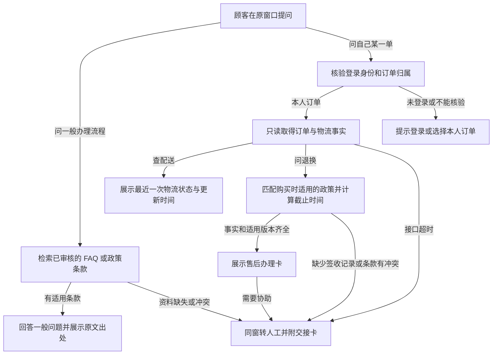

# 第二版实施方案 · 知识问答与本人订单售后

第一版已经验收同窗转人工、坐席接单、断线恢复和模型超时自动转接。第二版沿用单店、网页、单坐席的范围，完成原计划的第二步「接知识和订单」。第一个可演示的问题是「上周买的活动商品今天签收，还能申请退货吗？」。

## 顾客怎样得到答案

图中的政策适用时间以示例店铺的下单规则为例。真实政策应分别配置「用哪个业务时间选版本」和「从哪个时间起算期限」。两者常常不同。

## 按模块地图实施

| 顺序 | 交付物 | 模块边界与可观察结果 |
| --- | --- | --- |
| 1 | 测试身份、只读订单与物流 | 建立独立的订单适配模块。服务端从已验证的登录状态取得顾客身份，按该顾客查询订单。访客会话编号只用于恢复聊天。调试页记录核验结果、查询耗时和错误类别。 |
| 2 | 版本化政策库与 FAQ | 每条资料包含条款编号、版本、正文、适用商品或活动、渠道、有效区间和发布状态。通用咨询检索已发布条款；历史订单可引用当时适用的历史版本。回答可展开当次引用的原文。 |
| 3 | 资格判断与售后办理卡 | 业务模块根据核验过的订单事实和结构化规则计算资格、截止时间。DeepSeek 负责解释结果。顾客看到结论、依据、截止时间和下一步；资料不足时显示待确认项。演示卡可引导原窗口转人工，真实店铺有办理链接时再接该入口。 |
| 4 | 人工交接与独立调试后台 | 转接时将顾客诉求、已核验事实、条款版本、待确认项和转接原因随会话交给坐席。交接卡可直接由结构化结果生成，模型故障时仍可使用。在现有地图上增加身份核验、订单查询、条款检索、资格判断节点，按会话查看各步运行结果。调试页使用编号、版本、耗时和错误类别，订单明细留在授权的业务界面。 |

聊天界面继续复用 assistant-ui；订单工具接入已有 AI SDK；接单和实时收发沿用 Socket.IO。会话继续写入 SQLite。起步时两版政策可通过 SQLite 的字段精确筛选，中文问答先用已审核的问法和别名。拿到实际未命中问题后，再评估 PostgreSQL + pgvector 的语义检索收益，资格判断始终由业务规则执行。[AI SDK 工具调用](https://ai-sdk.dev/docs/ai-sdk-core/tools-and-tool-calling) · [pgvector 项目](https://github.com/pgvector/pgvector)

## 开工需要的资料

- 两个独立测试账号 A、B。订单覆盖政策切换前后、已签收和未签收状态，并提供物流更新时间。首轮可以使用明确标注的模拟数据。
- 同一种商品的两版政策和一组已审核 FAQ。每版给出生效日、适用范围、起算点、日历日或工作日、店铺时区，以及截止当天能否办理。
- 对接真实店铺时需要顾客登录身份的获取方式、只读订单及物流接口、字段样例和实际售后入口。先用模拟适配器验收相同的输入输出，再替换数据来源。

## 验收脚本

以下期限仅用于测试。示例店铺按下单时间选择版本，11 月 15 日零时切换政策，旧版 7 个日历日，新版 14 个日历日，均从签收次日算第 1 天。店铺使用北京时间。

| 用例 | 必须看见的结果 |
| --- | --- |
| 同一 FAQ 两种问法 | 回答均能打开正确的已发布条款。遇到无依据的问题说明资料不足，并提供转接。 |
| 本人查单与跨账号查单 | A 能查自己的订单和物流更新时间。B 输入 A 的订单号，得到与订单不存在一致的提示；界面和传给模型的上下文都不含 A 的订单数据。 |
| 政策切换 | A 的两笔订单分别在 11 月 14 日和 15 日下单，均于 16 日签收。办理卡应分别引用旧版和新版，截止日分别为 11 月 23 日和 30 日。 |
| 截止边界 | 固定验收时钟。旧单在 11 月 23 日 23:59:59 可申请，到 24 日 00:00 即已过期。 |
| 事实缺失或规则冲突 | 未签收的订单不给出虚构的截止日；同优先级条款冲突时，转人工并标出冲突版本。 |
| 订单接口超时 | 顾客仍在原窗口，坐席收到交接卡；独立调试图指出订单查询超时，同时显示已经完成的身份核验。另行回放第一版 AI 超时案例，故障定位应落在 AI 模型节点。 |
| 发布新政策 | 对同一批案例回放，列出变更前后的资格、版本、截止日及差异原因。旧订单仍应得到正确的历史条款。 |

首轮把上述输入、固定时钟和预期结果写成可重复执行的用例。规则结果用程序逐项断言，回答内容检查条款引用和事实一致性。后续可复用 Promptfoo 批量回放接口用例。[Promptfoo HTTP 测试文档](https://www.promptfoo.dev/docs/providers/http/)

本版交付点是顾客、坐席和维护者能针对同一笔订单看到一致且有据可查的结果。通过上述验收后，再进入原计划第三步，用脱敏历史咨询回放并准备小流量试点。
